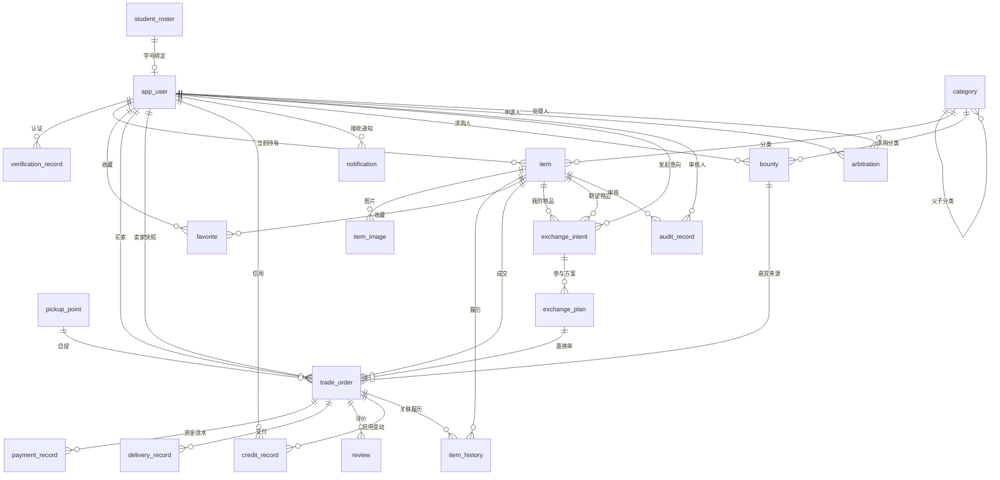

# 「拾光集」数据库开发文档

> **面向**：后端开发、数据库设计、联调测试
>
> **依据**：`docs/01-业务流程说明.md`、`docs/02-数据存储清单与业务对照.md`、`docs/03-接口文档.md`、`frontend/src/types/index.ts`
>
> **口径**：1 个 MySQL 数据库、21 张表；本文给出物理表名、字段类型、主外键、唯一约束、索引、Flyway 落地方式和 MyBatis-Plus 映射约定。

---

## 1. 环境与总体约定

| 项 | 约定 |
|---|---|
| 数据库 | MySQL 8.0.16+（需要 CHECK、生成列、utf8mb4_0900_ai_ci）；已在 8.4.11 验证通过 |
| 数据库名 | `shiguangji` |
| 字符集 | `utf8mb4` |
| 排序规则 | `utf8mb4_0900_ai_ci` |
| 存储引擎 | InnoDB |
| 时区 | 统一东八区；连接串 `serverTimezone=Asia/Shanghai` |
| 物理表命名 | 英文 snake_case、单数；避开 `user`、`order` 等保留字 |
| 主键 | 业务编号或自增 BIGINT UNSIGNED |
| 金额 | `DECIMAL(10,2)`；平台汇总用 `DECIMAL(14,2)` |
| 时间 | `DATETIME`，不使用数据库时区转换 |
| 枚举 | 存字符串 code，不存序号；关键枚举加 CHECK |
| 删除 | 不做物理级联删除；全部 `ON DELETE RESTRICT` |
| 迁移 | Flyway，脚本只增不改 |

### 1.1 生产部署选择（2026-11-24 确认）

- 服务器：Linux 单机，Docker Compose
- 数据库：先用 **Docker MySQL 8.4 LTS 容器 + named volume**，暂不购买 RDS
- 访问：暂无域名/备案，先用公网 IP + HTTP；后续补 HTTPS
- 备份：每日 `mysqldump` + uploads 打包，保留 14 天，需演练恢复
- 后续迁 RDS：只改 `DB_HOST / DB_USERNAME / DB_PASSWORD`，导入 dump 即可，Flyway 不变
- 部署细节见 [docs/05-部署文档.md](05-部署文档.md)

建库：

```sql
CREATE DATABASE shiguangji
  DEFAULT CHARACTER SET utf8mb4
  COLLATE utf8mb4_0900_ai_ci;
```

---

## 2. 物理表清单（21 张）

| # | 逻辑名 | 物理表名 | 说明 |
|---|---|---|---|
| 1 | 学籍表 | `student_roster` | 校方导入，认证比对源 |
| 2 | 用户表 | `app_user` | 账号、角色、认证、信用、余额 |
| 3 | 认证记录表 | `verification_record` | 每次认证申请与核验 |
| 4 | 分类表 | `category` | 最多两级，自关联 |
| 5 | 物品表 | `item` | 一件物品的完整信息与状态 |
| 6 | 物品图片表 | `item_image` | 有效图 / 历史图 |
| 7 | 履历记录表 | `item_history` | 建档、成交、置换、退货、维修 |
| 8 | 订单表 | `trade_order` | 普通订单 / 置换单 |
| 9 | 支付记录表 | `payment_record` | 充值、支付、放款、退款、扣回 |
| 10 | 平台账户表 | `platform_account` | 托管池，单行 |
| 11 | 交付记录表 | `delivery_record` | 面交 / 自提节点 |
| 12 | 自提点表 | `pickup_point` | 校内自提点 |
| 13 | 评价表 | `review` | 双向评价，一单一评 |
| 14 | 信用记录表 | `credit_record` | 信用分流水 |
| 15 | 悬赏单表 | `bounty` | 求购条件与状态 |
| 16 | 置换意向表 | `exchange_intent` | 我想用哪件物品换什么 |
| 17 | 置换方案表 | `exchange_plan` | 二人 / 三人环方案 |
| 18 | 通知表 | `notification` | 平台通知 |
| 19 | 收藏表 | `favorite` | 用户收藏 |
| 20 | 审核记录表 | `audit_record` | 发布审核留痕 |
| 21 | 仲裁申请表 | `arbitration` | 用户仲裁与裁定 |

---

## 3. ER 关系图



完整外键清单见 `docs/02` 第 40 条关系表，本文第 5 节按表重复列出。

---

## 4. 枚举与数据库 code

| 字段 | code 取值 |
|---|---|
| `app_user.role` | `student` / `operator` / `admin` |
| `app_user.verify_status` | `unverified` / `verified` / `rejected` |
| `item.status` | `pending` / `on_sale` / `locked` / `completed` / `rejected` / `off_shelf` / `frozen` |
| `item.condition_code` | `new` / `like_new` / `good` / `fair` / `poor` |
| `item.source` | `platform` / `offline` |
| `item.notes_tag` | `with_notes` / `with_answers` / `no_notes` |
| `item_image.status` | `active` / `history` |
| `item_history.event_type` | `created` / `deal` / `exchange` / `return` / `repair` |
| `trade_order.order_type` | `normal` / `exchange` |
| `trade_order.trade_status` | `pending_payment` / `pending_delivery` / `pending_confirm` / `completed` / `cancelled` |
| `trade_order.after_sale_status` | `none` / `refunding` / `arbitrating` / `refunded` |
| `trade_order.delivery_method` | `meetup` / `pickup` |
| `payment_record.account_type` | `user` / `platform` |
| `payment_record.payment_type` | `recharge` / `payment` / `payout` / `refund` / `chargeback` |
| `payment_record.status` | `success` / `failed`（只落成功流水，保留字段） |
| `review.status` | `valid` / `void` / `system` |
| `bounty.status` | `open` / `matched` / `closed` / `expired` |
| `exchange_intent.match_type` | `specific` / `condition` |
| `exchange_intent.status` | `active` / `matched` / `cancelled` |
| `exchange_plan.status` | `pending` / `active` / `void` / `completed` |
| `notification.notification_type` | `verification` / `audit` / `bounty_match` / `exchange_invite` / `aftersale_result` / `arbitration_accepted` / `arbitration_result` / `order_completed` |
| `audit_record.result` | `approved` / `rejected` |
| `arbitration.object_type` | `order` / `item` / `user` / `review` |
| `arbitration.status` | `pending` / `resolved` |
| `arbitration.result` | `buyer` / `seller` / NULL |
| `verification_record.result` | `approved` / `rejected` |

---

## 5. 表设计

### 5.1 `student_roster` 学籍表

| 字段 | 类型 | 空 | 默认 | 说明 |
|---|---|---|---|---|
| student_no | VARCHAR(20) | 否 | — | 学号，PK |
| name | VARCHAR(32) | 否 | — | 姓名 |
| college | VARCHAR(64) | 否 | — | 学院 |
| major | VARCHAR(64) | 否 | — | 专业 |
| grade | VARCHAR(10) | 否 | — | 年级 |
| created_at | DATETIME | 否 | CURRENT_TIMESTAMP | 导入时间 |
| updated_at | DATETIME | 否 | CURRENT_TIMESTAMP ON UPDATE | 更新时间 |

- PK：`student_no`
- 索引：`college`、`name`
- 被 `app_user.student_no` 引用；被引用时不可删除

### 5.2 `app_user` 用户表

| 字段 | 类型 | 空 | 默认 | 说明 |
|---|---|---|---|---|
| user_id | BIGINT UNSIGNED | 否 | AUTO_INCREMENT | 用户号，PK |
| username | VARCHAR(32) | 否 | — | 登录账号，唯一 |
| password_hash | VARCHAR(100) | 否 | — | BCrypt 哈希 |
| nickname | VARCHAR(32) | 否 | — | 昵称 |
| student_no | VARCHAR(20) | 是 | NULL | 认证后绑定，唯一 |
| role | VARCHAR(16) | 否 | `student` | 角色 |
| verify_status | VARCHAR(16) | 否 | `unverified` | 认证状态 |
| credit_score | INT | 否 | 100 | 当前信用分 |
| banned | TINYINT(1) | 否 | 0 | 是否封禁 |
| banned_until | DATETIME | 是 | NULL | 封禁到期时间 |
| contact | VARCHAR(64) | 是 | NULL | 联系方式 |
| balance | DECIMAL(10,2) | 否 | 0.00 | 当前余额，可为负 |
| created_at | DATETIME | 否 | CURRENT_TIMESTAMP | 注册时间 |
| updated_at | DATETIME | 否 | CURRENT_TIMESTAMP ON UPDATE | 更新时间 |

- 唯一：`username`、`student_no`（MySQL 允许多个 NULL）
- 外键：`student_no → student_roster.student_no`
- CHECK：角色、认证状态、信用分 ≥0、banned ∈ {0,1}
- 余额允许负数，但支付前必须校验足够余额

### 5.3 `verification_record` 认证记录表

| 字段 | 类型 | 空 | 说明 |
|---|---|---|---|
| verification_id | BIGINT UNSIGNED | 否 | PK |
| user_id | BIGINT UNSIGNED | 否 | 申请用户 |
| method | VARCHAR(16) | 否 | 默认 `manual` |
| submitted_student_no | VARCHAR(20) | 否 | 本次提交学号 |
| submitted_name | VARCHAR(32) | 否 | 本次提交姓名 |
| submitted_college | VARCHAR(64) | 是 | 本次提交学院 |
| submitted_major | VARCHAR(64) | 是 | 本次提交专业 |
| submitted_grade | VARCHAR(10) | 是 | 本次提交年级 |
| result | VARCHAR(16) | 否 | `approved` / `rejected` |
| reject_reason | VARCHAR(255) | 是 | 驳回原因 |
| applied_at | DATETIME | 否 | 申请时间 |
| verified_at | DATETIME | 是 | 核验时间 |
| created_at | DATETIME | 否 | 创建时间 |

- 每次提交新增一条，不覆盖历史
- 认证通过后再绑定 `app_user.student_no`

### 5.4 `category` 分类表

| 字段 | 类型 | 空 | 说明 |
|---|---|---|---|
| category_id | BIGINT UNSIGNED | 否 | PK |
| name | VARCHAR(64) | 否 | 分类名 |
| parent_id | BIGINT UNSIGNED | 是 | 父分类；一级为空 |
| enabled | TINYINT(1) | 否 | 是否启用 |
| parent_key | BIGINT UNSIGNED | 生成列 | `IFNULL(parent_id,0)` |
| created_at / updated_at | DATETIME | 否 | — |

- 自关联 FK：`parent_id → category.category_id`
- 唯一：`(parent_key, name)`，用生成列把 NULL 父级统一为 0，解决 MySQL “NULL 不参与唯一”的问题；同时覆盖一级分类名唯一
- 最多两级由 Service 校验
- 被物品引用或有子分类时不可删除

### 5.5 `pickup_point` 自提点表

| 字段 | 类型 | 空 | 说明 |
|---|---|---|---|
| pickup_point_id | BIGINT UNSIGNED | 否 | PK |
| name | VARCHAR(64) | 否 | 名称 |
| address | VARCHAR(128) | 否 | 地址 |
| coordinate | VARCHAR(64) | 是 | 坐标（可选） |
| created_at / updated_at | DATETIME | 否 | — |

### 5.6 `item` 物品表

| 字段 | 类型 | 空 | 默认 | 说明 |
|---|---|---|---|---|
| item_id | BIGINT UNSIGNED | 否 | AUTO_INCREMENT | 物品编号，PK；终身不变 |
| title | VARCHAR(120) | 否 | — | 标题 |
| category_id | BIGINT UNSIGNED | 否 | — | 分类 |
| current_holder_id | BIGINT UNSIGNED | 否 | — | 当前持有人 |
| price | DECIMAL(10,2) | 否 | — | 售价 |
| original_price | DECIMAL(10,2) | 否 | — | 原价 |
| purchase_price | DECIMAL(10,2) | 是 | NULL | 入手价 |
| condition_code | VARCHAR(16) | 否 | — | 成色（避开保留字 condition） |
| description | TEXT | 是 | NULL | 描述 |
| status | VARCHAR(16) | 否 | `pending` | 物品状态 |
| source | VARCHAR(16) | 否 | `offline` | 来源 |
| notes_tag | VARCHAR(20) | 否 | `no_notes` | 笔记标签 |
| listed_at | DATETIME | 是 | NULL | 上架时间 |
| reject_reason | VARCHAR(255) | 是 | NULL | 驳回原因 |
| created_at / updated_at | DATETIME | 否 | — | — |

- FK：`category_id → category`；`current_holder_id → app_user`
- CHECK：状态、成色、来源、笔记、价格 ≥0
- 索引：
  - `idx_item_status_category (status, category_id, created_at)`：首页/搜索
  - `idx_item_holder (current_holder_id, status)`：我的物品
  - `idx_item_price (price)`：价格排序
- 关键词搜索当前用 `LIKE '%keyword%'`，普通索引无效；课程项目可接受，数据量大时再评估 ngram FULLTEXT
- 物品编号不随转手变化；F10 再次上架复用原编号

### 5.7 `item_image` 物品图片表

| 字段 | 类型 | 空 | 说明 |
|---|---|---|---|
| image_id | BIGINT UNSIGNED | 否 | PK |
| item_id | BIGINT UNSIGNED | 否 | 物品 |
| path | VARCHAR(255) | 否 | 图片路径/URL（接口返回 `url`） |
| sort_order | INT | 否 | 排序 |
| is_cover | TINYINT(1) | 否 | 是否首图 |
| status | VARCHAR(16) | 否 | `active` / `history` |
| active_cover_item | BIGINT UNSIGNED | 生成列 | 有效首图时等于 item_id |
| created_at | DATETIME | 否 | — |

- 生成列：`IF(is_cover=1 AND status='active', item_id, NULL)`
- 唯一：`active_cover_item`，保证每件物品只有一张**有效**首图；历史图不参与
- FK：`item_id → item`
- 索引：`(item_id, status)`

### 5.8 `bounty` 悬赏单表

| 字段 | 类型 | 空 | 默认 | 说明 |
|---|---|---|---|---|
| bounty_id | BIGINT UNSIGNED | 否 | AUTO_INCREMENT | PK |
| buyer_id | BIGINT UNSIGNED | 否 | — | 求购人 |
| category_id | BIGINT UNSIGNED | 否 | — | 分类 |
| keyword | VARCHAR(64) | 否 | — | 关键词 |
| budget | DECIMAL(10,2) | 否 | — | 预算 |
| condition_code | VARCHAR(16) | 否 | — | 期望成色 |
| price_tolerance | DECIMAL(5,2) | 否 | 20.00 | 价格容差百分比 |
| status | VARCHAR(16) | 否 | `open` | 状态 |
| match_count | INT | 否 | 0 | 命中次数 |
| created_at | DATETIME | 否 | — | 发布时间 |
| expires_at | DATETIME | 否 | — | 有效期 |
| closed_at | DATETIME | 是 | NULL | 关闭/过期时间 |

- FK：`buyer_id → app_user`、`category_id → category`
- 索引：`(status, expires_at)`、`(buyer_id, status)`
- 同一买家最多 3 条 `open` 由 Service 校验

### 5.9 `exchange_intent` 置换意向表

| 字段 | 类型 | 空 | 说明 |
|---|---|---|---|
| intent_id | BIGINT UNSIGNED | 否 | PK |
| user_id | BIGINT UNSIGNED | 否 | 发起人 |
| my_item_id | BIGINT UNSIGNED | 否 | 我的物品 |
| match_type | VARCHAR(16) | 否 | `specific` / `condition` |
| target_item_id | BIGINT UNSIGNED | 是 | 指定期望物品 |
| target_category_id | BIGINT UNSIGNED | 是 | 条件匹配分类 |
| keyword | VARCHAR(64) | 是 | 条件匹配关键词 |
| status | VARCHAR(16) | 否 | `active` / `matched` / `cancelled` |
| active_item_id | BIGINT UNSIGNED | 生成列 | 有效时等于 my_item_id |
| created_at | DATETIME | 否 | — |

- 生成列 + 唯一：`active_item_id`，保证同一物品只有一条有效意向
- FK：`user_id`、`my_item_id`、`target_item_id`、`target_category_id`
- CHECK：`specific` 必须有 `target_item_id`；`condition` 必须有分类或非空关键词

### 5.10 `exchange_plan` 置换方案表

| 字段 | 类型 | 空 | 说明 |
|---|---|---|---|
| plan_id | BIGINT UNSIGNED | 否 | PK |
| ring_type | TINYINT UNSIGNED | 否 | 2 / 3 |
| intent_a_id | BIGINT UNSIGNED | 否 | 第一方意向 |
| intent_b_id | BIGINT UNSIGNED | 是 | 第二方意向（三人环必填） |
| intent_c_id | BIGINT UNSIGNED | 是 | 第三方意向（三人环必填） |
| status | VARCHAR(16) | 否 | 待确认/已生效/已作废/已完成 |
| confirm_deadline | DATETIME | 否 | 确认截止 |
| confirmed_a_at / b / c | DATETIME | 是 | 各方确认时间 |
| created_at / updated_at | DATETIME | 否 | — |

- FK：三个意向号 → `exchange_intent`
- CHECK：`ring_type=2` 时 B/C 为空；`ring_type=3` 时 B/C 非空
- 索引：`(status, confirm_deadline)`

### 5.11 `trade_order` 订单表

| 字段 | 类型 | 空 | 默认 | 说明 |
|---|---|---|---|---|
| order_no | VARCHAR(32) | 否 | — | 订单号，PK |
| order_type | VARCHAR(16) | 否 | `normal` | 普通 / 置换 |
| buyer_id | BIGINT UNSIGNED | 否 | — | 买家快照 |
| seller_id | BIGINT UNSIGNED | 否 | — | 卖家快照（成交时持有人） |
| item_id | BIGINT UNSIGNED | 否 | — | 物品 |
| amount | DECIMAL(10,2) | 否 | 0.00 | 金额 |
| delivery_method | VARCHAR(16) | 否 | — | 面交 / 自提 |
| pickup_point_id | BIGINT UNSIGNED | 是 | NULL | 自提点 |
| trade_status | VARCHAR(24) | 否 | `pending_payment` | 交易状态 |
| after_sale_status | VARCHAR(16) | 否 | `none` | 售后状态 |
| source_bounty_id | BIGINT UNSIGNED | 是 | NULL | 来源悬赏 |
| plan_id | BIGINT UNSIGNED | 是 | NULL | 置换方案 |
| pay_deadline / confirm_deadline | DATETIME | 是 | NULL | 超时时间 |
| paid_at / completed_at / cancelled_at | DATETIME | 是 | NULL | 节点时间 |
| created_at / updated_at | DATETIME | 否 | — | — |

- FK：买家、卖家、物品、自提点、悬赏、方案
- 索引：`(buyer_id, created_at)`、`(seller_id, created_at)`、`(item_id)`、`(trade_status)`、`(after_sale_status)`、`(plan_id)`、`(source_bounty_id)`
- CHECK：类型、交付方式、交易状态、售后状态、金额 ≥0
- 订单里的买家/卖家/金额是**快照**；物品当前持有人是**现值**

### 5.12 `payment_record` 支付记录表

| 字段 | 类型 | 空 | 说明 |
|---|---|---|---|
| payment_id | BIGINT UNSIGNED | 否 | PK |
| order_no | VARCHAR(32) | 是 | 可空，充值没有订单 |
| account_type | VARCHAR(16) | 否 | user / platform |
| user_id | BIGINT UNSIGNED | 是 | 平台流水为空 |
| account_identifier | BIGINT UNSIGNED | 否 | 用户流水=user_id；平台流水=platform_account.account_no |
| payment_type | VARCHAR(16) | 否 | recharge/payment/payout/refund/chargeback |
| amount | DECIMAL(10,2) | 否 | 金额，正数 |
| balance_snapshot | DECIMAL(14,2) | 否 | 对应账户余额快照 |
| status | VARCHAR(16) | 否 | 默认 success，只落成功流水 |
| payment_method | VARCHAR(16) | 否 | 默认 wallet |
| external_no | VARCHAR(64) | 否 | 外部单号，唯一 |
| created_at | DATETIME | 否 | 时间 |
| remark | VARCHAR(255) | 是 | 备注 |

- 唯一：`external_no`；`(order_no, payment_type, account_identifier)`
- FK：`order_no → trade_order`、`user_id → app_user`
- 索引：`(user_id, created_at)`、`(order_no)`、`(account_identifier)`
- 充值流水：`order_no=NULL`、`account_type=user`、`account_identifier=user_id`，不进平台托管
- 平台流水：`user_id=NULL`、`account_identifier=1`
- 同一订单同一类型同一账户只允许一条流水，唯一键兜底

### 5.13 `platform_account` 平台账户表

| 字段 | 类型 | 空 | 说明 |
|---|---|---|---|
| account_no | BIGINT UNSIGNED | 否 | PK，固定为 1 |
| escrow_balance | DECIMAL(14,2) | 否 | 托管余额 |
| total_inflow | DECIMAL(14,2) | 否 | 累计流入 |
| total_outflow | DECIMAL(14,2) | 否 | 累计流出 |
| updated_at | DATETIME | 否 | — |

- 单行表：初始化插入 `account_no=1`
- 校验：`escrow_balance = total_inflow - total_outflow`（Service + 对账任务；DDL 中加非负 CHECK）
- 不收充值款，只收订单托管

### 5.14 `delivery_record` 交付记录表

| 字段 | 类型 | 空 | 说明 |
|---|---|---|---|
| delivery_id | BIGINT UNSIGNED | 否 | PK |
| order_no | VARCHAR(32) | 否 | 订单 |
| method | VARCHAR(16) | 否 | meetup / pickup |
| agreed_time | DATETIME | 是 | 面交约定时间 |
| meetup_place | VARCHAR(128) | 是 | 面交地点 |
| pickup_code | VARCHAR(16) | 是 | 取件码，唯一 |
| verify_time | DATETIME | 是 | 面交核验时间 |
| inbound_time | DATETIME | 是 | 自提入库时间 |
| outbound_time | DATETIME | 是 | 自提出库时间 |
| pickup_point_id | BIGINT UNSIGNED | 是 | 自提点 |
| created_at / updated_at | DATETIME | 否 | — |

- FK：订单、自提点
- 唯一：`pickup_code`（面交为空，允许多个 NULL）
- 索引：`order_no`、`pickup_point_id`
- 用时间戳表达进度，不设交付状态字段

### 5.15 `review` 评价表

| 字段 | 类型 | 空 | 说明 |
|---|---|---|---|
| review_id | BIGINT UNSIGNED | 否 | PK |
| order_no | VARCHAR(32) | 否 | 订单 |
| reviewer_id | BIGINT UNSIGNED | 否 | 评价人 |
| target_user_id | BIGINT UNSIGNED | 否 | 被评人 |
| rating | TINYINT UNSIGNED | 否 | 1–5 |
| tags | JSON | 是 | 标签数组 |
| content | VARCHAR(500) | 是 | 内容 |
| status | VARCHAR(16) | 否 | valid / void / system |
| created_at | DATETIME | 否 | — |

- 唯一：`(order_no, reviewer_id)`，一单一评
- FK：订单、评价人、被评人
- 索引：`(target_user_id)`
- 评价只影响展示，不改履历和信用

### 5.16 `credit_record` 信用记录表

| 字段 | 类型 | 空 | 说明 |
|---|---|---|---|
| credit_id | BIGINT UNSIGNED | 否 | PK |
| user_id | BIGINT UNSIGNED | 否 | 用户 |
| change_value | INT | 否 | 变动值，可为负 |
| reason | VARCHAR(32) | 否 | 原因 |
| order_no | VARCHAR(32) | 是 | 可空 |
| created_at | DATETIME | 否 | — |

- 唯一：`(user_id, order_no, reason)`，防重复加分
- FK：用户、订单
- 索引：`(user_id, created_at)`
- 当前信用分在 `app_user.credit_score`，本表是流水

### 5.17 `item_history` 履历记录表

| 字段 | 类型 | 空 | 说明 |
|---|---|---|---|
| history_id | BIGINT UNSIGNED | 否 | PK |
| item_id | BIGINT UNSIGNED | 否 | 物品 |
| event_type | VARCHAR(16) | 否 | created/deal/exchange/return/repair |
| event_time | DATETIME | 否 | 事件时间 |
| description | VARCHAR(255) | 否 | 描述 |
| related_user_id | BIGINT UNSIGNED | 是 | 关联用户 |
| order_no | VARCHAR(32) | 是 | 关联订单 |
| message | VARCHAR(255) | 是 | 卖家寄语 |
| created_at | DATETIME | 否 | — |

- FK：物品、订单、关联用户
- 索引：`(item_id, event_time)`
- 只由系统写入，用户不可修改

### 5.18 `notification` 通知表

| 字段 | 类型 | 空 | 说明 |
|---|---|---|---|
| notification_id | BIGINT UNSIGNED | 否 | PK |
| receiver_id | BIGINT UNSIGNED | 否 | 接收人 |
| notification_type | VARCHAR(32) | 否 | 8 种通知类型 |
| related_type | VARCHAR(32) | 是 | 多态：item/order/bounty/arbitration |
| related_id | VARCHAR(64) | 是 | 多态编号 |
| content | VARCHAR(500) | 否 | 内容 |
| is_read | TINYINT(1) | 否 | 默认 0 |
| read_at | DATETIME | 是 | 阅读时间 |
| created_at | DATETIME | 否 | — |

- FK：接收人
- 索引：`(receiver_id, is_read, created_at)`
- 关联对象多态，不建外键

### 5.19 `favorite` 收藏表

| 字段 | 类型 | 空 | 说明 |
|---|---|---|---|
| favorite_id | BIGINT UNSIGNED | 否 | PK |
| user_id | BIGINT UNSIGNED | 否 | 用户 |
| item_id | BIGINT UNSIGNED | 否 | 物品 |
| created_at | DATETIME | 否 | — |

- 唯一：`(user_id, item_id)`
- FK：用户、物品
- 索引：`item_id`

### 5.20 `audit_record` 审核记录表

| 字段 | 类型 | 空 | 说明 |
|---|---|---|---|
| audit_id | BIGINT UNSIGNED | 否 | PK |
| item_id | BIGINT UNSIGNED | 否 | 物品 |
| auditor_id | BIGINT UNSIGNED | 否 | 审核人 |
| result | VARCHAR(16) | 否 | approved / rejected |
| reason | VARCHAR(255) | 是 | 驳回理由 |
| created_at | DATETIME | 否 | — |

- FK：物品、审核人
- 索引：`(item_id, created_at)`、`(auditor_id)`
- 审核结论留痕；物品状态由物品服务更新

### 5.21 `arbitration` 仲裁申请表

| 字段 | 类型 | 空 | 说明 |
|---|---|---|---|
| arbitration_id | BIGINT UNSIGNED | 否 | PK |
| applicant_id | BIGINT UNSIGNED | 否 | 申请人 |
| object_type | VARCHAR(16) | 否 | order/item/user/review |
| object_id | VARCHAR(64) | 否 | 对象编号 |
| arbitration_type | VARCHAR(32) | 否 | 虚假描述/违禁/爽约/骚扰/违规评价 |
| evidence | VARCHAR(1000) | 是 | 举证 |
| status | VARCHAR(16) | 否 | pending / resolved |
| result | VARCHAR(16) | 是 | buyer / seller / NULL |
| handler_id | BIGINT UNSIGNED | 是 | 处理人 |
| created_at | DATETIME | 否 | 申请时间 |
| resolved_at | DATETIME | 是 | 处理时间 |

- FK：申请人、处理人
- 索引：`(status, created_at)`、`(applicant_id)`、`(object_type, object_id)`
- 对象多态，不建外键

---

## 6. 索引与约束汇总

### 6.1 唯一约束

| 表 | 唯一键 | 作用 |
|---|---|---|
| app_user | username | 登录账号唯一 |
| app_user | student_no | 一个学号一个账号 |
| category | (parent_key, name) | 同级分类不重名 |
| item_image | active_cover_item | 每件物品一张有效首图 |
| payment_record | external_no | 外部单号唯一 |
| payment_record | (order_no, payment_type, account_identifier) | 同订单同类型同账户一条 |
| review | (order_no, reviewer_id) | 一单一评 |
| favorite | (user_id, item_id) | 不重复收藏 |
| credit_record | (user_id, order_no, reason) | 防重复信用流水 |
| delivery_record | pickup_code | 取件码唯一 |
| exchange_intent | active_item_id | 同一物品一条有效意向 |

### 6.2 关键索引

| 表 | 索引 | 场景 |
|---|---|---|
| item | (status, category_id, created_at) | 首页 / 搜索 |
| item | (current_holder_id, status) | 我的物品 |
| item | (price) | 价格排序 |
| item_image | (item_id, status) | 详情图 |
| item_history | (item_id, event_time) | 履历时间线 |
| trade_order | (buyer_id, created_at) | 我买到的 |
| trade_order | (seller_id, created_at) | 我卖出的 |
| trade_order | (trade_status) | 待支付/待确认任务 |
| payment_record | (user_id, created_at) | 钱包流水 |
| notification | (receiver_id, is_read, created_at) | 通知列表 |
| bounty | (status, expires_at) | 悬赏大厅/到期 |
| exchange_intent | (user_id, status) | 我的意向 |
| exchange_plan | (status, confirm_deadline) | 待确认方案 |
| audit_record | (item_id, created_at) | 审核记录 |
| arbitration | (status, created_at) | 待处理仲裁 |

### 6.3 外键行为

全部使用：

```sql
ON DELETE RESTRICT ON UPDATE RESTRICT
```

原因：

- 物品、订单、流水、履历都是历史数据，不能因删用户/分类而消失
- 分类、自提点被引用时阻止删除，正好对应 F14 规则
- 不采用级联删除，避免误删交易链

---

## 7. 完整建表 DDL

> 可直接作为 `backend/src/main/resources/db/migration/V1__schema.sql`，按依赖顺序执行。

建表顺序说明：学籍、分类、自提点、平台账户 → 用户 → 认证记录 → 物品、图片 → 悬赏、置换意向、置换方案 → 订单 → 支付、交付、评价、信用、履历、通知、收藏、审核、仲裁。`item_history` 引用了订单，因此放在订单之后创建。

```sql
-- =========================================================
-- 拾光集 · 校园二手交易平台 · V1 schema
-- MySQL 8.0.16+
-- =========================================================

CREATE TABLE student_roster (
  student_no   VARCHAR(20)  NOT NULL COMMENT '学号',
  name         VARCHAR(32)  NOT NULL COMMENT '姓名',
  college      VARCHAR(64)  NOT NULL COMMENT '学院',
  major        VARCHAR(64)  NOT NULL COMMENT '专业',
  grade        VARCHAR(10)  NOT NULL COMMENT '年级',
  created_at   DATETIME     NOT NULL DEFAULT CURRENT_TIMESTAMP,
  updated_at   DATETIME     NOT NULL DEFAULT CURRENT_TIMESTAMP ON UPDATE CURRENT_TIMESTAMP,
  PRIMARY KEY (student_no),
  KEY idx_roster_college (college),
  KEY idx_roster_name (name)
) ENGINE=InnoDB DEFAULT CHARSET=utf8mb4 COLLATE=utf8mb4_0900_ai_ci COMMENT='学籍表';

CREATE TABLE category (
  category_id  BIGINT UNSIGNED NOT NULL AUTO_INCREMENT COMMENT '分类号',
  name         VARCHAR(64)     NOT NULL COMMENT '分类名',
  parent_id    BIGINT UNSIGNED NULL COMMENT '父分类号',
  enabled      TINYINT(1)      NOT NULL DEFAULT 1 COMMENT '是否启用',
  parent_key   BIGINT UNSIGNED GENERATED ALWAYS AS (IFNULL(parent_id, 0)) STORED COMMENT '父级键，用于同级唯一',
  created_at   DATETIME        NOT NULL DEFAULT CURRENT_TIMESTAMP,
  updated_at   DATETIME        NOT NULL DEFAULT CURRENT_TIMESTAMP ON UPDATE CURRENT_TIMESTAMP,
  PRIMARY KEY (category_id),
  UNIQUE KEY uk_category_parent_name (parent_key, name),
  KEY idx_category_parent (parent_id),
  CONSTRAINT fk_category_parent FOREIGN KEY (parent_id) REFERENCES category (category_id)
    ON DELETE RESTRICT ON UPDATE RESTRICT,
  CONSTRAINT ck_category_enabled CHECK (enabled IN (0,1))
) ENGINE=InnoDB DEFAULT CHARSET=utf8mb4 COLLATE=utf8mb4_0900_ai_ci COMMENT='分类表';

CREATE TABLE pickup_point (
  pickup_point_id BIGINT UNSIGNED NOT NULL AUTO_INCREMENT COMMENT '自提点号',
  name            VARCHAR(64)     NOT NULL COMMENT '名称',
  address         VARCHAR(128)    NOT NULL COMMENT '地址',
  coordinate      VARCHAR(64)     NULL COMMENT '坐标',
  created_at      DATETIME        NOT NULL DEFAULT CURRENT_TIMESTAMP,
  updated_at      DATETIME        NOT NULL DEFAULT CURRENT_TIMESTAMP ON UPDATE CURRENT_TIMESTAMP,
  PRIMARY KEY (pickup_point_id)
) ENGINE=InnoDB DEFAULT CHARSET=utf8mb4 COLLATE=utf8mb4_0900_ai_ci COMMENT='自提点表';

CREATE TABLE platform_account (
  account_no      BIGINT UNSIGNED NOT NULL COMMENT '平台账户号，固定 1',
  escrow_balance  DECIMAL(14,2)   NOT NULL DEFAULT 0.00 COMMENT '托管余额',
  total_inflow    DECIMAL(14,2)   NOT NULL DEFAULT 0.00 COMMENT '累计流入',
  total_outflow   DECIMAL(14,2)   NOT NULL DEFAULT 0.00 COMMENT '累计流出',
  updated_at      DATETIME        NOT NULL DEFAULT CURRENT_TIMESTAMP ON UPDATE CURRENT_TIMESTAMP,
  PRIMARY KEY (account_no),
  CONSTRAINT ck_platform_balance CHECK (escrow_balance >= 0 AND total_inflow >= 0 AND total_outflow >= 0)
) ENGINE=InnoDB DEFAULT CHARSET=utf8mb4 COLLATE=utf8mb4_0900_ai_ci COMMENT='平台托管账户（单行）';

CREATE TABLE app_user (
  user_id        BIGINT UNSIGNED NOT NULL AUTO_INCREMENT COMMENT '用户号',
  username       VARCHAR(32)     NOT NULL COMMENT '登录用户名',
  password_hash  VARCHAR(100)    NOT NULL COMMENT 'BCrypt 密码哈希',
  nickname       VARCHAR(32)     NOT NULL COMMENT '昵称',
  student_no     VARCHAR(20)     NULL COMMENT '绑定学号',
  role           VARCHAR(16)     NOT NULL DEFAULT 'student' COMMENT '角色',
  verify_status  VARCHAR(16)     NOT NULL DEFAULT 'unverified' COMMENT '认证状态',
  credit_score   INT             NOT NULL DEFAULT 100 COMMENT '信用分',
  banned         TINYINT(1)      NOT NULL DEFAULT 0 COMMENT '是否封禁',
  banned_until   DATETIME        NULL COMMENT '封禁到期时间',
  contact        VARCHAR(64)     NULL COMMENT '联系方式',
  balance        DECIMAL(10,2)   NOT NULL DEFAULT 0.00 COMMENT '余额，可为负',
  created_at     DATETIME        NOT NULL DEFAULT CURRENT_TIMESTAMP,
  updated_at     DATETIME        NOT NULL DEFAULT CURRENT_TIMESTAMP ON UPDATE CURRENT_TIMESTAMP,
  PRIMARY KEY (user_id),
  UNIQUE KEY uk_user_username (username),
  UNIQUE KEY uk_user_student_no (student_no),
  KEY idx_user_role (role),
  KEY idx_user_verify (verify_status),
  CONSTRAINT fk_user_student FOREIGN KEY (student_no) REFERENCES student_roster (student_no)
    ON DELETE RESTRICT ON UPDATE RESTRICT,
  CONSTRAINT ck_user_role CHECK (role IN ('student','operator','admin')),
  CONSTRAINT ck_user_verify CHECK (verify_status IN ('unverified','verified','rejected')),
  CONSTRAINT ck_user_credit CHECK (credit_score >= 0),
  CONSTRAINT ck_user_banned CHECK (banned IN (0,1))
) ENGINE=InnoDB DEFAULT CHARSET=utf8mb4 COLLATE=utf8mb4_0900_ai_ci COMMENT='用户表';

CREATE TABLE verification_record (
  verification_id      BIGINT UNSIGNED NOT NULL AUTO_INCREMENT COMMENT '认证号',
  user_id              BIGINT UNSIGNED NOT NULL COMMENT '用户号',
  method               VARCHAR(16)     NOT NULL DEFAULT 'manual' COMMENT '认证方式',
  submitted_student_no VARCHAR(20)     NOT NULL COMMENT '提交学号',
  submitted_name       VARCHAR(32)     NOT NULL COMMENT '提交姓名',
  submitted_college    VARCHAR(64)     NULL COMMENT '提交学院',
  submitted_major      VARCHAR(64)     NULL COMMENT '提交专业',
  submitted_grade      VARCHAR(10)     NULL COMMENT '提交年级',
  result               VARCHAR(16)     NOT NULL COMMENT '核验结果',
  reject_reason        VARCHAR(255)    NULL COMMENT '驳回原因',
  applied_at           DATETIME        NOT NULL DEFAULT CURRENT_TIMESTAMP COMMENT '申请时间',
  verified_at          DATETIME        NULL COMMENT '核验时间',
  created_at           DATETIME        NOT NULL DEFAULT CURRENT_TIMESTAMP,
  PRIMARY KEY (verification_id),
  KEY idx_verification_user (user_id, applied_at),
  KEY idx_verification_result (result),
  CONSTRAINT fk_verification_user FOREIGN KEY (user_id) REFERENCES app_user (user_id)
    ON DELETE RESTRICT ON UPDATE RESTRICT,
  CONSTRAINT ck_verification_result CHECK (result IN ('approved','rejected'))
) ENGINE=InnoDB DEFAULT CHARSET=utf8mb4 COLLATE=utf8mb4_0900_ai_ci COMMENT='认证记录表';

CREATE TABLE item (
  item_id           BIGINT UNSIGNED NOT NULL AUTO_INCREMENT COMMENT '物品编号',
  title             VARCHAR(120)    NOT NULL COMMENT '标题',
  category_id       BIGINT UNSIGNED NOT NULL COMMENT '分类号',
  current_holder_id BIGINT UNSIGNED NOT NULL COMMENT '当前持有人',
  price             DECIMAL(10,2)   NOT NULL COMMENT '售价',
  original_price    DECIMAL(10,2)   NOT NULL COMMENT '原价',
  purchase_price    DECIMAL(10,2)   NULL COMMENT '入手价',
  condition_code    VARCHAR(16)     NOT NULL COMMENT '成色',
  description       TEXT            NULL COMMENT '描述',
  status            VARCHAR(16)     NOT NULL DEFAULT 'pending' COMMENT '物品状态',
  source            VARCHAR(16)     NOT NULL DEFAULT 'offline' COMMENT '来源',
  notes_tag         VARCHAR(20)     NOT NULL DEFAULT 'no_notes' COMMENT '笔记标签',
  listed_at         DATETIME        NULL COMMENT '上架时间',
  reject_reason     VARCHAR(255)    NULL COMMENT '驳回原因',
  created_at        DATETIME        NOT NULL DEFAULT CURRENT_TIMESTAMP,
  updated_at        DATETIME        NOT NULL DEFAULT CURRENT_TIMESTAMP ON UPDATE CURRENT_TIMESTAMP,
  PRIMARY KEY (item_id),
  KEY idx_item_status_category (status, category_id, created_at),
  KEY idx_item_holder (current_holder_id, status),
  KEY idx_item_price (price),
  CONSTRAINT fk_item_category FOREIGN KEY (category_id) REFERENCES category (category_id)
    ON DELETE RESTRICT ON UPDATE RESTRICT,
  CONSTRAINT fk_item_holder FOREIGN KEY (current_holder_id) REFERENCES app_user (user_id)
    ON DELETE RESTRICT ON UPDATE RESTRICT,
  CONSTRAINT ck_item_status CHECK (status IN ('pending','on_sale','locked','completed','rejected','off_shelf','frozen')),
  CONSTRAINT ck_item_condition CHECK (condition_code IN ('new','like_new','good','fair','poor')),
  CONSTRAINT ck_item_source CHECK (source IN ('platform','offline')),
  CONSTRAINT ck_item_notes CHECK (notes_tag IN ('with_notes','with_answers','no_notes')),
  CONSTRAINT ck_item_price CHECK (price >= 0 AND original_price >= 0 AND (purchase_price IS NULL OR purchase_price >= 0))
) ENGINE=InnoDB DEFAULT CHARSET=utf8mb4 COLLATE=utf8mb4_0900_ai_ci COMMENT='物品表';

CREATE TABLE item_image (
  image_id          BIGINT UNSIGNED NOT NULL AUTO_INCREMENT COMMENT '图片号',
  item_id           BIGINT UNSIGNED NOT NULL COMMENT '物品编号',
  path              VARCHAR(255)    NOT NULL COMMENT '图片路径/URL',
  sort_order        INT             NOT NULL DEFAULT 0 COMMENT '排序',
  is_cover          TINYINT(1)      NOT NULL DEFAULT 0 COMMENT '是否首图',
  status            VARCHAR(16)     NOT NULL DEFAULT 'active' COMMENT '有效/历史',
  active_cover_item BIGINT UNSIGNED GENERATED ALWAYS AS
    (IF(is_cover = 1 AND status = 'active', item_id, NULL)) STORED COMMENT '有效首图键',
  created_at        DATETIME        NOT NULL DEFAULT CURRENT_TIMESTAMP,
  PRIMARY KEY (image_id),
  UNIQUE KEY uk_item_image_active_cover (active_cover_item),
  KEY idx_item_image_item (item_id, status),
  CONSTRAINT fk_item_image_item FOREIGN KEY (item_id) REFERENCES item (item_id)
    ON DELETE RESTRICT ON UPDATE RESTRICT,
  CONSTRAINT ck_item_image_cover CHECK (is_cover IN (0,1)),
  CONSTRAINT ck_item_image_status CHECK (status IN ('active','history'))
) ENGINE=InnoDB DEFAULT CHARSET=utf8mb4 COLLATE=utf8mb4_0900_ai_ci COMMENT='物品图片表';

CREATE TABLE bounty (
  bounty_id       BIGINT UNSIGNED NOT NULL AUTO_INCREMENT COMMENT '悬赏号',
  buyer_id        BIGINT UNSIGNED NOT NULL COMMENT '求购人',
  category_id     BIGINT UNSIGNED NOT NULL COMMENT '分类号',
  keyword         VARCHAR(64)     NOT NULL COMMENT '关键词',
  budget          DECIMAL(10,2)   NOT NULL COMMENT '预算',
  condition_code  VARCHAR(16)     NOT NULL COMMENT '期望成色',
  price_tolerance DECIMAL(5,2)    NOT NULL DEFAULT 20.00 COMMENT '价格容差 %',
  status          VARCHAR(16)     NOT NULL DEFAULT 'open' COMMENT '状态',
  match_count     INT             NOT NULL DEFAULT 0 COMMENT '命中次数',
  created_at      DATETIME        NOT NULL DEFAULT CURRENT_TIMESTAMP,
  expires_at      DATETIME        NOT NULL COMMENT '有效期',
  closed_at       DATETIME        NULL COMMENT '关闭/过期时间',
  PRIMARY KEY (bounty_id),
  KEY idx_bounty_status_expires (status, expires_at),
  KEY idx_bounty_buyer (buyer_id, status),
  CONSTRAINT fk_bounty_buyer FOREIGN KEY (buyer_id) REFERENCES app_user (user_id)
    ON DELETE RESTRICT ON UPDATE RESTRICT,
  CONSTRAINT fk_bounty_category FOREIGN KEY (category_id) REFERENCES category (category_id)
    ON DELETE RESTRICT ON UPDATE RESTRICT,
  CONSTRAINT ck_bounty_status CHECK (status IN ('open','matched','closed','expired')),
  CONSTRAINT ck_bounty_condition CHECK (condition_code IN ('new','like_new','good','fair','poor')),
  CONSTRAINT ck_bounty_amount CHECK (budget >= 0 AND price_tolerance >= 0)
) ENGINE=InnoDB DEFAULT CHARSET=utf8mb4 COLLATE=utf8mb4_0900_ai_ci COMMENT='悬赏单表';

CREATE TABLE exchange_intent (
  intent_id          BIGINT UNSIGNED NOT NULL AUTO_INCREMENT COMMENT '意向号',
  user_id            BIGINT UNSIGNED NOT NULL COMMENT '用户号',
  my_item_id         BIGINT UNSIGNED NOT NULL COMMENT '我的物品',
  match_type         VARCHAR(16)     NOT NULL COMMENT '指定物品/条件匹配',
  target_item_id     BIGINT UNSIGNED NULL COMMENT '期望物品',
  target_category_id BIGINT UNSIGNED NULL COMMENT '期望分类',
  keyword            VARCHAR(64)     NULL COMMENT '期望关键词',
  status             VARCHAR(16)     NOT NULL DEFAULT 'active' COMMENT '状态',
  active_item_id     BIGINT UNSIGNED GENERATED ALWAYS AS
    (IF(status = 'active', my_item_id, NULL)) STORED COMMENT '有效意向物品键',
  created_at         DATETIME        NOT NULL DEFAULT CURRENT_TIMESTAMP,
  PRIMARY KEY (intent_id),
  UNIQUE KEY uk_exchange_intent_active_item (active_item_id),
  KEY idx_exchange_intent_user (user_id, status),
  CONSTRAINT fk_intent_user FOREIGN KEY (user_id) REFERENCES app_user (user_id)
    ON DELETE RESTRICT ON UPDATE RESTRICT,
  CONSTRAINT fk_intent_my_item FOREIGN KEY (my_item_id) REFERENCES item (item_id)
    ON DELETE RESTRICT ON UPDATE RESTRICT,
  CONSTRAINT fk_intent_target_item FOREIGN KEY (target_item_id) REFERENCES item (item_id)
    ON DELETE RESTRICT ON UPDATE RESTRICT,
  CONSTRAINT fk_intent_target_category FOREIGN KEY (target_category_id) REFERENCES category (category_id)
    ON DELETE RESTRICT ON UPDATE RESTRICT,
  CONSTRAINT ck_intent_match CHECK (
    (match_type = 'specific' AND target_item_id IS NOT NULL)
    OR
    (match_type = 'condition' AND (target_category_id IS NOT NULL OR (keyword IS NOT NULL AND keyword <> '')))
  ),
  CONSTRAINT ck_intent_status CHECK (status IN ('active','matched','cancelled'))
) ENGINE=InnoDB DEFAULT CHARSET=utf8mb4 COLLATE=utf8mb4_0900_ai_ci COMMENT='置换意向表';

CREATE TABLE exchange_plan (
  plan_id         BIGINT UNSIGNED NOT NULL AUTO_INCREMENT COMMENT '方案号',
  ring_type       TINYINT UNSIGNED NOT NULL COMMENT '2 人 / 3 人',
  intent_a_id     BIGINT UNSIGNED NOT NULL COMMENT '意向 A',
  intent_b_id     BIGINT UNSIGNED NULL COMMENT '意向 B',
  intent_c_id     BIGINT UNSIGNED NULL COMMENT '意向 C',
  status          VARCHAR(16)     NOT NULL DEFAULT 'pending' COMMENT '状态',
  confirm_deadline DATETIME       NOT NULL COMMENT '确认截止',
  confirmed_a_at  DATETIME        NULL COMMENT 'A 确认时间',
  confirmed_b_at  DATETIME        NULL COMMENT 'B 确认时间',
  confirmed_c_at  DATETIME        NULL COMMENT 'C 确认时间',
  created_at      DATETIME        NOT NULL DEFAULT CURRENT_TIMESTAMP,
  updated_at      DATETIME        NOT NULL DEFAULT CURRENT_TIMESTAMP ON UPDATE CURRENT_TIMESTAMP,
  PRIMARY KEY (plan_id),
  KEY idx_exchange_plan_status (status, confirm_deadline),
  CONSTRAINT fk_plan_intent_a FOREIGN KEY (intent_a_id) REFERENCES exchange_intent (intent_id)
    ON DELETE RESTRICT ON UPDATE RESTRICT,
  CONSTRAINT fk_plan_intent_b FOREIGN KEY (intent_b_id) REFERENCES exchange_intent (intent_id)
    ON DELETE RESTRICT ON UPDATE RESTRICT,
  CONSTRAINT fk_plan_intent_c FOREIGN KEY (intent_c_id) REFERENCES exchange_intent (intent_id)
    ON DELETE RESTRICT ON UPDATE RESTRICT,
  CONSTRAINT ck_plan_ring CHECK (ring_type IN (2,3)),
  CONSTRAINT ck_plan_participants CHECK (
    (ring_type = 2 AND intent_b_id IS NULL AND intent_c_id IS NULL)
    OR
    (ring_type = 3 AND intent_b_id IS NOT NULL AND intent_c_id IS NOT NULL)
  ),
  CONSTRAINT ck_plan_status CHECK (status IN ('pending','active','void','completed'))
) ENGINE=InnoDB DEFAULT CHARSET=utf8mb4 COLLATE=utf8mb4_0900_ai_ci COMMENT='置换方案表';

CREATE TABLE trade_order (
  order_no           VARCHAR(32)     NOT NULL COMMENT '订单号',
  order_type         VARCHAR(16)     NOT NULL DEFAULT 'normal' COMMENT '普通/置换',
  buyer_id           BIGINT UNSIGNED NOT NULL COMMENT '买家快照',
  seller_id          BIGINT UNSIGNED NOT NULL COMMENT '卖家快照',
  item_id            BIGINT UNSIGNED NOT NULL COMMENT '物品编号',
  amount             DECIMAL(10,2)   NOT NULL DEFAULT 0.00 COMMENT '金额',
  delivery_method    VARCHAR(16)     NOT NULL COMMENT '面交/自提',
  pickup_point_id    BIGINT UNSIGNED NULL COMMENT '自提点',
  trade_status       VARCHAR(24)     NOT NULL DEFAULT 'pending_payment' COMMENT '交易状态',
  after_sale_status  VARCHAR(16)     NOT NULL DEFAULT 'none' COMMENT '售后状态',
  source_bounty_id   BIGINT UNSIGNED NULL COMMENT '来源悬赏',
  plan_id            BIGINT UNSIGNED NULL COMMENT '置换方案',
  pay_deadline       DATETIME        NULL COMMENT '支付截止',
  confirm_deadline   DATETIME        NULL COMMENT '自动确认截止',
  paid_at            DATETIME        NULL,
  completed_at       DATETIME        NULL,
  cancelled_at       DATETIME        NULL,
  created_at         DATETIME        NOT NULL DEFAULT CURRENT_TIMESTAMP,
  updated_at         DATETIME        NOT NULL DEFAULT CURRENT_TIMESTAMP ON UPDATE CURRENT_TIMESTAMP,
  PRIMARY KEY (order_no),
  KEY idx_order_buyer (buyer_id, created_at),
  KEY idx_order_seller (seller_id, created_at),
  KEY idx_order_item (item_id),
  KEY idx_order_status (trade_status),
  KEY idx_order_after_sale (after_sale_status),
  KEY idx_order_plan (plan_id),
  KEY idx_order_bounty (source_bounty_id),
  CONSTRAINT fk_order_buyer FOREIGN KEY (buyer_id) REFERENCES app_user (user_id)
    ON DELETE RESTRICT ON UPDATE RESTRICT,
  CONSTRAINT fk_order_seller FOREIGN KEY (seller_id) REFERENCES app_user (user_id)
    ON DELETE RESTRICT ON UPDATE RESTRICT,
  CONSTRAINT fk_order_item FOREIGN KEY (item_id) REFERENCES item (item_id)
    ON DELETE RESTRICT ON UPDATE RESTRICT,
  CONSTRAINT fk_order_pickup FOREIGN KEY (pickup_point_id) REFERENCES pickup_point (pickup_point_id)
    ON DELETE RESTRICT ON UPDATE RESTRICT,
  CONSTRAINT fk_order_bounty FOREIGN KEY (source_bounty_id) REFERENCES bounty (bounty_id)
    ON DELETE RESTRICT ON UPDATE RESTRICT,
  CONSTRAINT fk_order_plan FOREIGN KEY (plan_id) REFERENCES exchange_plan (plan_id)
    ON DELETE RESTRICT ON UPDATE RESTRICT,
  CONSTRAINT ck_order_type CHECK (order_type IN ('normal','exchange')),
  CONSTRAINT ck_order_delivery CHECK (delivery_method IN ('meetup','pickup')),
  CONSTRAINT ck_order_trade_status CHECK (trade_status IN ('pending_payment','pending_delivery','pending_confirm','completed','cancelled')),
  CONSTRAINT ck_order_after_sale CHECK (after_sale_status IN ('none','refunding','arbitrating','refunded')),
  CONSTRAINT ck_order_amount CHECK (amount >= 0)
) ENGINE=InnoDB DEFAULT CHARSET=utf8mb4 COLLATE=utf8mb4_0900_ai_ci COMMENT='订单表';

CREATE TABLE payment_record (
  payment_id        BIGINT UNSIGNED NOT NULL AUTO_INCREMENT COMMENT '流水号',
  order_no          VARCHAR(32)     NULL COMMENT '订单号，充值可空',
  account_type      VARCHAR(16)     NOT NULL COMMENT '用户/平台',
  user_id           BIGINT UNSIGNED NULL COMMENT '用户号，平台流水为空',
  account_identifier BIGINT UNSIGNED NOT NULL COMMENT '账户标识：用户号/平台账户号',
  payment_type      VARCHAR(16)     NOT NULL COMMENT '充值/支付/放款/退款/扣回',
  amount            DECIMAL(10,2)   NOT NULL COMMENT '金额',
  balance_snapshot  DECIMAL(14,2)   NOT NULL COMMENT '对应账户余额快照',
  status            VARCHAR(16)     NOT NULL DEFAULT 'success' COMMENT '状态',
  payment_method    VARCHAR(16)     NOT NULL DEFAULT 'wallet' COMMENT '支付方式',
  external_no       VARCHAR(64)     NOT NULL COMMENT '外部单号',
  remark            VARCHAR(255)    NULL COMMENT '备注',
  created_at        DATETIME        NOT NULL DEFAULT CURRENT_TIMESTAMP,
  PRIMARY KEY (payment_id),
  UNIQUE KEY uk_payment_external (external_no),
  UNIQUE KEY uk_payment_order_type_account (order_no, payment_type, account_identifier),
  KEY idx_payment_user (user_id, created_at),
  KEY idx_payment_order (order_no),
  KEY idx_payment_account (account_identifier),
  CONSTRAINT fk_payment_order FOREIGN KEY (order_no) REFERENCES trade_order (order_no)
    ON DELETE RESTRICT ON UPDATE RESTRICT,
  CONSTRAINT fk_payment_user FOREIGN KEY (user_id) REFERENCES app_user (user_id)
    ON DELETE RESTRICT ON UPDATE RESTRICT,
  CONSTRAINT ck_payment_account CHECK (account_type IN ('user','platform')),
  CONSTRAINT ck_payment_type CHECK (payment_type IN ('recharge','payment','payout','refund','chargeback')),
  CONSTRAINT ck_payment_status CHECK (status IN ('success','failed')),
  CONSTRAINT ck_payment_amount CHECK (amount > 0)
) ENGINE=InnoDB DEFAULT CHARSET=utf8mb4 COLLATE=utf8mb4_0900_ai_ci COMMENT='支付记录表';

CREATE TABLE delivery_record (
  delivery_id     BIGINT UNSIGNED NOT NULL AUTO_INCREMENT COMMENT '记录号',
  order_no        VARCHAR(32)     NOT NULL COMMENT '订单号',
  method          VARCHAR(16)     NOT NULL COMMENT '面交/自提',
  agreed_time     DATETIME        NULL COMMENT '约定时间',
  meetup_place    VARCHAR(128)    NULL COMMENT '面交地点',
  pickup_code     VARCHAR(16)     NULL COMMENT '取件码',
  verify_time     DATETIME        NULL COMMENT '核验时间',
  inbound_time    DATETIME        NULL COMMENT '入库时间',
  outbound_time   DATETIME        NULL COMMENT '出库时间',
  pickup_point_id BIGINT UNSIGNED NULL COMMENT '自提点',
  created_at      DATETIME        NOT NULL DEFAULT CURRENT_TIMESTAMP,
  updated_at      DATETIME        NOT NULL DEFAULT CURRENT_TIMESTAMP ON UPDATE CURRENT_TIMESTAMP,
  PRIMARY KEY (delivery_id),
  UNIQUE KEY uk_delivery_pickup_code (pickup_code),
  KEY idx_delivery_order (order_no),
  KEY idx_delivery_pickup_point (pickup_point_id),
  CONSTRAINT fk_delivery_order FOREIGN KEY (order_no) REFERENCES trade_order (order_no)
    ON DELETE RESTRICT ON UPDATE RESTRICT,
  CONSTRAINT fk_delivery_pickup FOREIGN KEY (pickup_point_id) REFERENCES pickup_point (pickup_point_id)
    ON DELETE RESTRICT ON UPDATE RESTRICT,
  CONSTRAINT ck_delivery_method CHECK (method IN ('meetup','pickup'))
) ENGINE=InnoDB DEFAULT CHARSET=utf8mb4 COLLATE=utf8mb4_0900_ai_ci COMMENT='交付记录表';

CREATE TABLE review (
  review_id      BIGINT UNSIGNED NOT NULL AUTO_INCREMENT COMMENT '评价号',
  order_no       VARCHAR(32)     NOT NULL COMMENT '订单号',
  reviewer_id    BIGINT UNSIGNED NOT NULL COMMENT '评价人',
  target_user_id BIGINT UNSIGNED NOT NULL COMMENT '被评人',
  rating         TINYINT UNSIGNED NOT NULL COMMENT '1-5',
  tags           JSON            NULL COMMENT '标签数组',
  content        VARCHAR(500)    NULL COMMENT '内容',
  status         VARCHAR(16)     NOT NULL DEFAULT 'valid' COMMENT '有效/作废/系统默认',
  created_at     DATETIME        NOT NULL DEFAULT CURRENT_TIMESTAMP,
  PRIMARY KEY (review_id),
  UNIQUE KEY uk_review_order_reviewer (order_no, reviewer_id),
  KEY idx_review_target (target_user_id),
  CONSTRAINT fk_review_order FOREIGN KEY (order_no) REFERENCES trade_order (order_no)
    ON DELETE RESTRICT ON UPDATE RESTRICT,
  CONSTRAINT fk_review_reviewer FOREIGN KEY (reviewer_id) REFERENCES app_user (user_id)
    ON DELETE RESTRICT ON UPDATE RESTRICT,
  CONSTRAINT fk_review_target FOREIGN KEY (target_user_id) REFERENCES app_user (user_id)
    ON DELETE RESTRICT ON UPDATE RESTRICT,
  CONSTRAINT ck_review_rating CHECK (rating BETWEEN 1 AND 5),
  CONSTRAINT ck_review_status CHECK (status IN ('valid','void','system'))
) ENGINE=InnoDB DEFAULT CHARSET=utf8mb4 COLLATE=utf8mb4_0900_ai_ci COMMENT='评价表';

CREATE TABLE credit_record (
  credit_id    BIGINT UNSIGNED NOT NULL AUTO_INCREMENT COMMENT '记录号',
  user_id      BIGINT UNSIGNED NOT NULL COMMENT '用户号',
  change_value INT             NOT NULL COMMENT '变动值',
  reason       VARCHAR(32)     NOT NULL COMMENT '原因',
  order_no     VARCHAR(32)     NULL COMMENT '关联订单',
  created_at   DATETIME        NOT NULL DEFAULT CURRENT_TIMESTAMP,
  PRIMARY KEY (credit_id),
  UNIQUE KEY uk_credit_user_order_reason (user_id, order_no, reason),
  KEY idx_credit_user (user_id, created_at),
  CONSTRAINT fk_credit_user FOREIGN KEY (user_id) REFERENCES app_user (user_id)
    ON DELETE RESTRICT ON UPDATE RESTRICT,
  CONSTRAINT fk_credit_order FOREIGN KEY (order_no) REFERENCES trade_order (order_no)
    ON DELETE RESTRICT ON UPDATE RESTRICT,
  CONSTRAINT ck_credit_change CHECK (change_value <> 0)
) ENGINE=InnoDB DEFAULT CHARSET=utf8mb4 COLLATE=utf8mb4_0900_ai_ci COMMENT='信用记录表';

CREATE TABLE item_history (
  history_id      BIGINT UNSIGNED NOT NULL AUTO_INCREMENT COMMENT '履历号',
  item_id         BIGINT UNSIGNED NOT NULL COMMENT '物品编号',
  event_type      VARCHAR(16)     NOT NULL COMMENT '事件类型',
  event_time      DATETIME        NOT NULL COMMENT '事件时间',
  description     VARCHAR(255)    NOT NULL COMMENT '描述',
  related_user_id BIGINT UNSIGNED NULL COMMENT '关联用户',
  order_no        VARCHAR(32)     NULL COMMENT '关联订单',
  message         VARCHAR(255)    NULL COMMENT '卖家寄语',
  created_at      DATETIME        NOT NULL DEFAULT CURRENT_TIMESTAMP,
  PRIMARY KEY (history_id),
  KEY idx_history_item (item_id, event_time),
  KEY idx_history_order (order_no),
  CONSTRAINT fk_history_item FOREIGN KEY (item_id) REFERENCES item (item_id)
    ON DELETE RESTRICT ON UPDATE RESTRICT,
  CONSTRAINT fk_history_order FOREIGN KEY (order_no) REFERENCES trade_order (order_no)
    ON DELETE RESTRICT ON UPDATE RESTRICT,
  CONSTRAINT fk_history_user FOREIGN KEY (related_user_id) REFERENCES app_user (user_id)
    ON DELETE RESTRICT ON UPDATE RESTRICT,
  CONSTRAINT ck_history_event CHECK (event_type IN ('created','deal','exchange','return','repair'))
) ENGINE=InnoDB DEFAULT CHARSET=utf8mb4 COLLATE=utf8mb4_0900_ai_ci COMMENT='履历记录表';

CREATE TABLE notification (
  notification_id  BIGINT UNSIGNED NOT NULL AUTO_INCREMENT COMMENT '通知号',
  receiver_id      BIGINT UNSIGNED NOT NULL COMMENT '接收人',
  notification_type VARCHAR(32)    NOT NULL COMMENT '通知类型',
  related_type     VARCHAR(32)     NULL COMMENT '多态类型',
  related_id       VARCHAR(64)     NULL COMMENT '多态编号',
  content          VARCHAR(500)    NOT NULL COMMENT '内容',
  is_read          TINYINT(1)      NOT NULL DEFAULT 0 COMMENT '是否已读',
  read_at          DATETIME        NULL COMMENT '阅读时间',
  created_at       DATETIME        NOT NULL DEFAULT CURRENT_TIMESTAMP,
  PRIMARY KEY (notification_id),
  KEY idx_notification_receiver (receiver_id, is_read, created_at),
  CONSTRAINT fk_notification_receiver FOREIGN KEY (receiver_id) REFERENCES app_user (user_id)
    ON DELETE RESTRICT ON UPDATE RESTRICT,
  CONSTRAINT ck_notification_read CHECK (is_read IN (0,1)),
  CONSTRAINT ck_notification_type CHECK (notification_type IN (
    'verification','audit','bounty_match','exchange_invite',
    'aftersale_result','arbitration_accepted','arbitration_result','order_completed'
  ))
) ENGINE=InnoDB DEFAULT CHARSET=utf8mb4 COLLATE=utf8mb4_0900_ai_ci COMMENT='通知表';

CREATE TABLE favorite (
  favorite_id BIGINT UNSIGNED NOT NULL AUTO_INCREMENT COMMENT '收藏号',
  user_id     BIGINT UNSIGNED NOT NULL COMMENT '用户号',
  item_id     BIGINT UNSIGNED NOT NULL COMMENT '物品编号',
  created_at  DATETIME        NOT NULL DEFAULT CURRENT_TIMESTAMP,
  PRIMARY KEY (favorite_id),
  UNIQUE KEY uk_favorite_user_item (user_id, item_id),
  KEY idx_favorite_item (item_id),
  CONSTRAINT fk_favorite_user FOREIGN KEY (user_id) REFERENCES app_user (user_id)
    ON DELETE RESTRICT ON UPDATE RESTRICT,
  CONSTRAINT fk_favorite_item FOREIGN KEY (item_id) REFERENCES item (item_id)
    ON DELETE RESTRICT ON UPDATE RESTRICT
) ENGINE=InnoDB DEFAULT CHARSET=utf8mb4 COLLATE=utf8mb4_0900_ai_ci COMMENT='收藏表';

CREATE TABLE audit_record (
  audit_id    BIGINT UNSIGNED NOT NULL AUTO_INCREMENT COMMENT '审核号',
  item_id     BIGINT UNSIGNED NOT NULL COMMENT '物品编号',
  auditor_id  BIGINT UNSIGNED NOT NULL COMMENT '审核人',
  result      VARCHAR(16)     NOT NULL COMMENT '通过/驳回',
  reason      VARCHAR(255)    NULL COMMENT '理由',
  created_at  DATETIME        NOT NULL DEFAULT CURRENT_TIMESTAMP,
  PRIMARY KEY (audit_id),
  KEY idx_audit_item (item_id, created_at),
  KEY idx_audit_auditor (auditor_id),
  CONSTRAINT fk_audit_item FOREIGN KEY (item_id) REFERENCES item (item_id)
    ON DELETE RESTRICT ON UPDATE RESTRICT,
  CONSTRAINT fk_audit_auditor FOREIGN KEY (auditor_id) REFERENCES app_user (user_id)
    ON DELETE RESTRICT ON UPDATE RESTRICT,
  CONSTRAINT ck_audit_result CHECK (result IN ('approved','rejected'))
) ENGINE=InnoDB DEFAULT CHARSET=utf8mb4 COLLATE=utf8mb4_0900_ai_ci COMMENT='审核记录表';

CREATE TABLE arbitration (
  arbitration_id   BIGINT UNSIGNED NOT NULL AUTO_INCREMENT COMMENT '仲裁号',
  applicant_id     BIGINT UNSIGNED NOT NULL COMMENT '申请人',
  object_type      VARCHAR(16)     NOT NULL COMMENT '对象类型',
  object_id        VARCHAR(64)     NOT NULL COMMENT '对象编号',
  arbitration_type VARCHAR(32)     NOT NULL COMMENT '仲裁类型',
  evidence         VARCHAR(1000)   NULL COMMENT '举证',
  status           VARCHAR(16)     NOT NULL DEFAULT 'pending' COMMENT '状态',
  result           VARCHAR(16)     NULL COMMENT '裁定结果',
  handler_id       BIGINT UNSIGNED NULL COMMENT '处理人',
  created_at       DATETIME        NOT NULL DEFAULT CURRENT_TIMESTAMP,
  resolved_at      DATETIME        NULL COMMENT '处理时间',
  PRIMARY KEY (arbitration_id),
  KEY idx_arbitration_status (status, created_at),
  KEY idx_arbitration_applicant (applicant_id),
  KEY idx_arbitration_object (object_type, object_id),
  CONSTRAINT fk_arbitration_applicant FOREIGN KEY (applicant_id) REFERENCES app_user (user_id)
    ON DELETE RESTRICT ON UPDATE RESTRICT,
  CONSTRAINT fk_arbitration_handler FOREIGN KEY (handler_id) REFERENCES app_user (user_id)
    ON DELETE RESTRICT ON UPDATE RESTRICT,
  CONSTRAINT ck_arbitration_object CHECK (object_type IN ('order','item','user','review')),
  CONSTRAINT ck_arbitration_status CHECK (status IN ('pending','resolved')),
  CONSTRAINT ck_arbitration_result CHECK (result IS NULL OR result IN ('buyer','seller'))
) ENGINE=InnoDB DEFAULT CHARSET=utf8mb4 COLLATE=utf8mb4_0900_ai_ci COMMENT='仲裁申请表';
```

> 注意：`condition` 是 MySQL 保留字，因此物品/悬赏使用 `condition_code`；实体字段仍可叫 `condition`，用 `@TableField("condition_code")` 映射。

---

## 8. 种子数据与 Flyway

### 8.1 迁移脚本规划

```
backend/src/main/resources/db/migration/
├─ V1__schema.sql        # 本文第 7 节 DDL
├─ V2__seed.sql          # 平台账户、分类、自提点
└─ V3__demo_data.sql     # 仅开发环境：学籍、演示用户、示例物品
```

规则：

- 已执行的脚本不能修改；新增变更用 `V4__...`
- `spring.flyway.clean-disabled=true`
- 开发重置数据库：删库重建后重新执行 Flyway，不要 `flyway clean`
- 生产不跑 `V3__demo_data.sql`

### 8.2 必需种子

```sql
INSERT INTO platform_account (account_no, escrow_balance, total_inflow, total_outflow)
VALUES (1, 0.00, 0.00, 0.00);

INSERT INTO category (category_id, name, parent_id, enabled) VALUES
  (1, '教材书籍', NULL, 1),
  (11, '考研专区', 1, 1),
  (12, '专业教材', 1, 1),
  (13, '课外读物', 1, 1),
  (2, '数码电子', NULL, 1),
  (21, '手机平板', 2, 1),
  (22, '电脑配件', 2, 1),
  (23, '影音设备', 2, 1),
  (3, '生活用品', NULL, 1),
  (31, '宿舍电器', 3, 1),
  (32, '日用杂物', 3, 1),
  (4, '运动户外', NULL, 1),
  (41, '球类器材', 4, 1),
  (42, '骑行装备', 4, 1),
  (5, '乐器', NULL, 1),
  (51, '吉他 / 键盘', 5, 1),
  (52, '其他乐器', 5, 1),
  (6, '美妆个护', NULL, 1),
  (61, '护肤', 6, 1),
  (62, '彩妆', 6, 1);

INSERT INTO pickup_point (pickup_point_id, name, address) VALUES
  (1, '菜鸟驿站（一食堂店）', '一食堂西门旁 12 号'),
  (2, '图书馆东门驿站', '图书馆东门一层'),
  (3, '南区宿舍服务站', '南区 7 号楼架空层');
```

管理员账号建议用 Spring Boot `ApplicationRunner` 创建，而不是把 BCrypt 哈希写死：

```java
if (userMapper.selectByUsername("admin") == null) {
    appUser.setUsername("admin");
    appUser.setNickname("校方管理员");
    appUser.setRole("admin");
    appUser.setVerifyStatus("verified");
    appUser.setPasswordHash(passwordEncoder.encode("123456"));
    userMapper.insert(appUser);
}
```

开发环境可同样生成 `operator`、`student`、`seller` 等演示账号；**生产环境必须关闭 bootstrap 或改初始密码**。

### 8.3 开发演示数据

`V3__demo_data.sql` 可选，建议包含：

- 学籍 6 条（与前端 mock 一致）
- 学生 `student / seller / suli / zhouye / guyan`，密码 BCrypt
- 8–10 件物品：在售、待审核、锁定、已完成各状态
- 订单、支付流水、评价、通知、悬赏、置换方案各少量
- 目的：前端 `VITE_USE_MOCK=false` 后可直接点通全部页面

演示数据不要写死 `user_id` 之外的自增序号；用变量或显式 ID + `ALTER TABLE ... AUTO_INCREMENT` 调整。

---

## 9. MyBatis-Plus 映射约定

### 9.1 实体

```java
@TableName("app_user")
public class AppUser {
    @TableId(value = "user_id", type = IdType.AUTO)
    private Long userId;

    private String username;
    private String passwordHash;
    private String nickname;
    private String studentNo;
    private String role;
    private String verifyStatus;
    private Integer creditScore;
    private Boolean banned;
    private LocalDateTime bannedUntil;
    private String contact;
    private BigDecimal balance;
    private LocalDateTime createdAt;
    private LocalDateTime updatedAt;
}
```

- 自增表用 `IdType.AUTO`；`trade_order` 用 `IdType.INPUT`，订单号由业务生成
- `item.condition_code` 映射：

```java
@TableField("condition_code")
private String condition;
```

- 表字段 `order_type`、`payment_type`、`notification_type`、`arbitration_type` 分别对应接口里的 `type`，实体可命名为 `type`，用 `@TableField` 显式映射
- `review.tags` JSON：

```java
@TableName(value = "review", autoResultMap = true)
public class Review {
    @TableField(typeHandler = JacksonTypeHandler.class)
    private List<String> tags;
}
```

> `autoResultMap = true` 必须加，否则查询时 JSON 字段不会走 `JacksonTypeHandler`。

- `created_at / updated_at` 用 `MetaObjectHandler` 自动填充
- 枚举建议用 `IEnum<String>` 或普通 String 常量，数据库存 code
- 不要用 `@TableLogic`，本项目不做逻辑删除

### 9.2 Mapper

- 常规 CRUD：`BaseMapper<T>`
- 复杂查询放 XML：
  - 物品搜索（动态条件 + 分类子查询）
  - 订单列表（按角色/状态）
  - 报表聚合（F13）
  - 对账查询
- 分页：如启用 MyBatis-Plus 分页插件，前端需同步改列表页

### 9.3 公共字段

```java
@TableField(fill = FieldFill.INSERT)
private LocalDateTime createdAt;

@TableField(fill = FieldFill.INSERT_UPDATE)
private LocalDateTime updatedAt;
```

`MetaObjectHandler` 统一写入 `LocalDateTime.now()`，与数据库 `CURRENT_TIMESTAMP` 二选一，避免双重赋值导致不一致。

---

## 10. 事务、锁与一致性

### 10.1 固定加锁顺序

```
物品 item → 订单 trade_order → 用户 app_user → 平台账户 platform_account
```

所有涉及多表的资金/状态操作按此顺序加行锁，避免死锁。

### 10.2 关键事务

| 场景 | 锁 | 写入 |
|---|---|---|
| 创建订单 | `item` 行锁 | `trade_order`、`item.status=locked` |
| 支付 | `trade_order`、买家 `app_user`、`platform_account` | 余额、托管、两条 `payment_record`、订单状态 |
| 确认收货 | 订单、物品、卖家、平台账户 | 放款、两条流水、物品归属、履历、信用、通知 |
| 退款 | 订单、买家/卖家、平台账户 | 退款/扣回流水、订单售后、物品、履历、评价、信用、通知 |
| 审核 | 物品行锁 | 物品状态、`audit_record`、通知 |
| 仲裁 | 仲裁行、订单、物品、双方用户、平台账户 | 裁定、资金、状态、履历、评价、信用、通知 |
| 置换确认 | 方案、参与意向、物品 | 方案状态、物品锁定/解锁、置换单 |

### 10.3 余额与流水

- `app_user.balance` 是当前值，必须能由 `payment_record` 汇总推出：

```
用户余额 = 充值 + 退款 + 放款 − 支付 − 扣回
```

- `platform_account.escrow_balance = total_inflow − total_outflow`
- 所有流水只增不改，带余额快照
- 支付扣款建议原子 SQL：

```sql
UPDATE app_user
SET balance = balance - #{amount}
WHERE user_id = #{userId} AND balance >= #{amount};
```

影响行数为 0 即余额不足。

### 10.4 幂等

- `payment_record.external_no` 唯一
- `(order_no, payment_type, account_identifier)` 唯一
- `review (order_no, reviewer_id)` 唯一
- `credit_record (user_id, order_no, reason)` 唯一
- 确认收货/审核/仲裁重复请求先查状态，已处理直接返回

### 10.5 一致性检查

```sql
-- 平台账户对账
SELECT account_no, escrow_balance, total_inflow - total_outflow AS calculated
FROM platform_account;

-- 用户余额与流水汇总
SELECT u.user_id, u.balance,
       COALESCE(SUM(CASE
         WHEN p.payment_type IN ('recharge','refund','payout') THEN p.amount
         WHEN p.payment_type IN ('payment','chargeback') THEN -p.amount
         ELSE 0 END), 0) AS calculated
FROM app_user u
LEFT JOIN payment_record p
  ON p.account_type = 'user' AND p.account_identifier = u.user_id
GROUP BY u.user_id, u.balance
HAVING u.balance <> calculated;
```

---

## 11. 常用查询与索引验证

### 11.1 物品搜索

```sql
SELECT i.*
FROM item i
WHERE i.status = 'on_sale'
  AND (#{keyword} IS NULL OR i.title LIKE CONCAT('%', #{keyword}, '%')
       OR i.description LIKE CONCAT('%', #{keyword}, '%'))
  AND (#{categoryId} IS NULL OR i.category_id IN (
        SELECT c.category_id FROM category c
        WHERE c.category_id = #{categoryId} OR c.parent_id = #{categoryId}
      ))
  AND (#{condition} IS NULL OR i.condition_code = #{condition})
ORDER BY i.created_at DESC
LIMIT 20;
```

### 11.2 我的订单

```sql
SELECT * FROM trade_order
WHERE buyer_id = #{userId}
  AND (#{status} IS NULL OR trade_status = #{status})
ORDER BY created_at DESC;
```

### 11.3 退款率（F13）

```sql
SELECT
  (SELECT COUNT(DISTINCT order_no)
     FROM payment_record
    WHERE account_type = 'user'
      AND payment_type IN ('refund','chargeback')) AS refund_orders,
  (SELECT COUNT(DISTINCT order_no)
     FROM payment_record
    WHERE account_type = 'user'
      AND payment_type = 'payment') AS paid_orders;
```

### 11.4 品类成交分布

```sql
SELECT i.category_id, c.name AS category_name,
       COUNT(*) AS order_count,
       COALESCE(SUM(o.amount), 0) AS amount
FROM trade_order o
JOIN item i ON i.item_id = o.item_id
JOIN category c ON c.category_id = i.category_id
WHERE o.trade_status = 'completed'
GROUP BY i.category_id, c.name
ORDER BY order_count DESC;
```

### 11.5 未读通知

```sql
SELECT * FROM notification
WHERE receiver_id = #{userId} AND is_read = 0
ORDER BY created_at DESC;
```

---

## 12. 运维与本地开发

### 12.1 本地初始化

```bash
# 1. 启动 MySQL（或 Docker Compose）
docker compose up -d mysql

# 2. 建库（首次）
mysql -uroot -p -e "CREATE DATABASE IF NOT EXISTS shiguangji DEFAULT CHARACTER SET utf8mb4 COLLATE utf8mb4_0900_ai_ci;"

# 3. 启动后端，Flyway 自动执行 V1/V2/V3
cd backend
mvn spring-boot:run
```

### 12.2 重置开发库

```sql
DROP DATABASE shiguangji;
CREATE DATABASE shiguangji DEFAULT CHARACTER SET utf8mb4 COLLATE utf8mb4_0900_ai_ci;
```

然后重启后端让 Flyway 重新迁移。**不要在生产执行。**

### 12.3 备份/恢复

```bash
# 备份
mysqldump -uroot -p --single-transaction --routines --triggers shiguangji > shiguangji.sql

# 恢复
mysql -uroot -p shiguangji < shiguangji.sql
```

### 12.4 连接串示例

```yaml
spring:
  datasource:
    url: jdbc:mysql://localhost:3306/shiguangji?useUnicode=true&characterEncoding=utf8&serverTimezone=Asia/Shanghai&allowPublicKeyRetrieval=true&useSSL=false
    username: root
    password: ${DB_PASSWORD:root}
```

---

## 13. 开发检查清单

- [ ] MySQL 8.0.16+，库/表字符集 utf8mb4
- [ ] 21 张表按顺序建表，40+ 外键全部落库
- [ ] 用户名、学号、评价、收藏、支付外部单号、支付账户组合、信用组合、分类同级名、有效首图、取件码、有效意向唯一约束全部生效
- [ ] 平台账户单行初始化为 `account_no=1`
- [ ] 分类、自提点、平台账户种子数据完成
- [ ] 管理员账号通过 bootstrap 创建，密码 BCrypt
- [ ] 物品 `condition_code`、订单 `order_type` 等保留字规避正确
- [ ] 金额 DECIMAL、时间 DATETIME、枚举字符串
- [ ] 支付/放款/退款双流水、余额快照、平台对账 SQL 可跑通
- [ ] 物品当前持有人与订单快照不混用
- [ ] 定时任务能扫描 `pay_deadline`、`confirm_deadline`、悬赏 `expires_at`、方案 `confirm_deadline`
- [ ] Flyway 脚本只增不改，开发重置通过删库重建
- [ ] 报表查询不落表，索引命中 `EXPLAIN` 检查通过

---

## 14. 实际验证记录

2026-11-24 使用本机 MySQL 8.4.11 临时实例执行：

| 项目 | 结果 |
|---|---|
| `V1__schema.sql` | 执行成功 |
| `V2__seed.sql` | 执行成功 |
| `flyway_schema_history` | V1 `schema`、V2 `seed` 均 success |
| 表数量 | 21 张业务表 + `flyway_schema_history` = 22 |
| 外键数量 | 40 |
| 种子数据 | 分类 20 条、自提点 3 条、平台账户 1 条 |

验证中发现并修正的问题：

- MySQL 不允许 `CHECK` 约束引用自增列，`ck_category_not_self` 已移除；父分类不能等于自身改由 Service 校验。

已知警告：

- Spring Boot 3.3.5 管理的 Flyway 对 MySQL 8.4 提示：`MySQL 8.4 is newer than this version of Flyway and support has not been tested. The latest supported version of MySQL is 8.1.`
- 该警告不影响本次迁移。当前决策：生产使用 MySQL 8.4 容器，上线前把 `flyway.version` 升级到支持 8.4 的版本并重新跑迁移；若升级存在兼容问题，生产数据库退回 MySQL 8.0 LTS。
